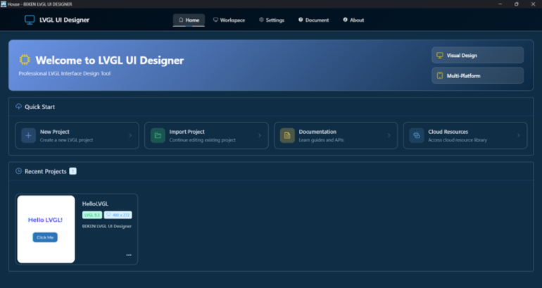
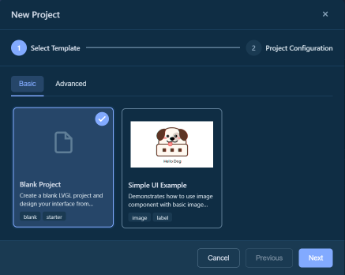
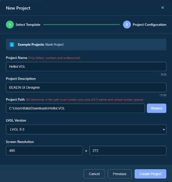
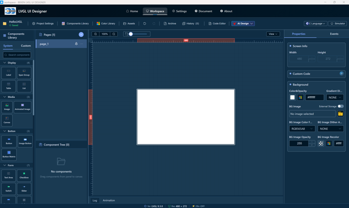
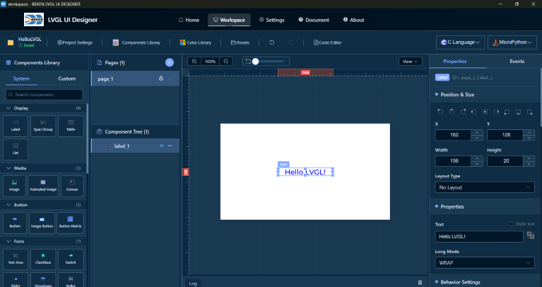
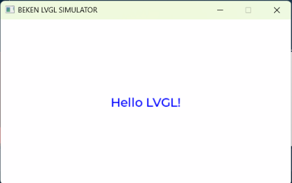

# Getting Started

This guide will help you quickly get started with BEKEN LVGL UI Designer and create your first UI project in 5 minutes.

## 🎯 Create Your First Project

### Step 1: Launch the Application

When you first launch BEKEN LVGL UI Designer, you will see the home page with the following options:
- **New Project** - Create a new UI project
- **Import Project** - Import an existing project
- **Recent Projects** - Quick access to recently used projects

### Step 2: Create a New Project

1. Click the **"New Project"** button
2. In the dialog that appears, select a project template:
   - **Blank Project** - Start from scratch
   - **Example Template** - Use a preset example project

3. Configure project information:
   - **Project Name**: Name your project (only numbers, letters, and underscores allowed)
   - **Save Location**: Choose the folder to save the project
   - **LVGL Version**: Choose the target LVGL version (8.4.0 and 9.3.0 are recommended; 9.2.2 / 9.4.0 / 9.5.0 / 9.6.0 are experimental)
   - **Screen Size**: Set the screen resolution of the target device (e.g., 480x272)

4. Click the **"Create"** button

### Step 3: Understand the Workspace

After creating the project, you will enter the workspace interface, which consists of 5 main areas:

- **Toolbar**: Project info, save, undo/redo, preview and other functions
- **Component Library**: All available UI components (buttons, labels, etc.)
- **Canvas**: Visual design area, drag components here
- **Component Tree**: Shows the hierarchy of pages and components
- **Properties Panel**: Edit properties and styles of selected components

## 🎨 Design Your First Interface

### Add a Label

1. Drag **"Label"** from the **Component Library** to the canvas
2. Find the **"Text"** property in the **Properties Panel**
3. Enter text: `Hello LVGL!`
4. Adjust font size and color:
   - Select the **"Font"** section
   - Set **Size** to 24
   - Set **Color** to blue

5. Adjust position and size:
   - Select the label in the **Canvas** and drag to adjust position
   - Drag edge control points to adjust size
   - Or enter precise values in the **Properties Panel**

## 💾 Save Project

- Projects are automatically saved (check the save status indicator in the toolbar)
- Or press `Ctrl + S` to manually save

## 📄 Preview and Generate Code

### Preview Interface

1. Click the **"Simulator"** button in the toolbar to open the built-in JS simulator and preview immediately with the project's LVGL version—no external toolchain required
2. Or click the **"C Language"** dropdown button and choose an operation:
   - **Generate+Compile+Run** - Compile and run in the external simulator window (for standard LVGL projects)
   - **Generate / Compile / Run** - Run each step separately
   - **Full Clean** - Clean up generated artifacts
3. The bottom **Log** panel opens automatically during execution, showing generation, compilation, and run output
4. Code is generated in the project directory

---

**Related Documents**: [Back to Home](index.md) | [Workspace Guide](workspace.md) | [FAQ](faq.md)

